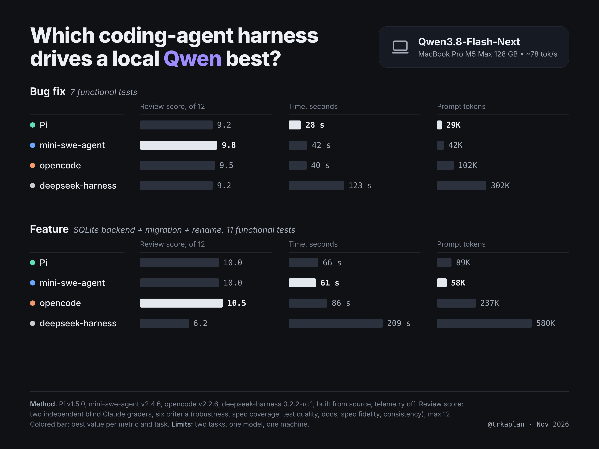
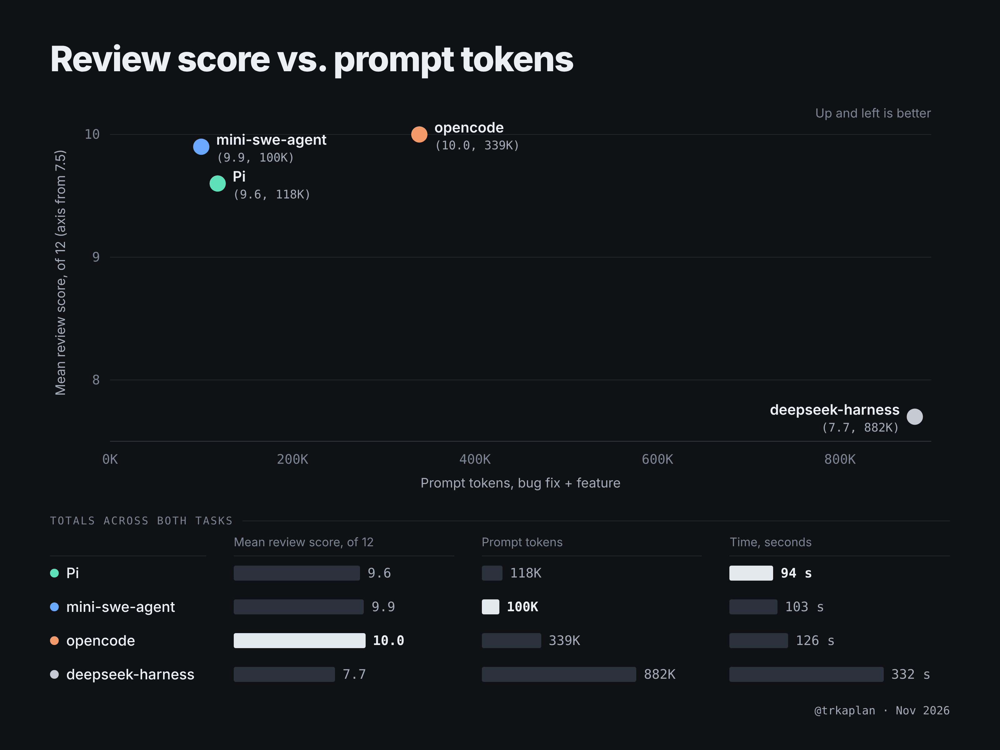

# local-harness-bench

Which open-source coding-agent harness drives a local model best? Four harnesses, one model, two tasks, hidden
tests, a telemetry audit, and a blind code-quality review. Everything needed to rerun it against your own
OpenAI-compatible endpoint is here.





In short: Pi is the fastest, mini-swe-agent uses the fewest tokens, opencode scores highest but at 3x the tokens of
those two, and deepseek-harness costs 7.5–8.8x the tokens for the lowest score. deepseek-harness was, however, the
only harness to test every numbered requirement; the other three all skipped the same one.

- **Model:** Qwen3.8-Flash-Next on an M5 Max 128 GB, served by oMLX (~78 tok/s), thinking off.
- **Harnesses:** [Pi](https://github.com/earendil-works/pi) v1.5.0, [opencode](https://github.com/anomalyco/opencode) v2.2.6,
  [mini-swe-agent](https://github.com/SWE-agent/mini-swe-agent) v2.4.6, [deepseek-harness](https://github.com/deepseek-ai/deepseek-harness) fcc0ad4.
  All built from source, all telemetry off, zero outbound connections verified with `lsof` sampling.
- **Full write-up:** [REPORT.md](REPORT.md) (setup, telemetry audit, results, blind review, prompt-rule experiment).

## Layout

| path | what |
|---|---|
| `setup.sh` | clones and builds the four harnesses at the pinned revisions into `src/` (gitignored) |
| `bin/run-one.sh <pi\|opencode\|mini\|dsh> <a-bugfix\|b-feature> <label>` | one run: fixture copy, harness headless, timing, tokens from server stats, network watch, hidden tests, diff |
| `bin/queue*.sh` | the sequences that produced `runs/` |
| `bin/netwatch.sh` | samples `lsof` on the harness process tree, logs any non-loopback connection |
| `bin/summary.py` | aggregates `runs/*/result.json` into the results tables |
| `RUBRIC.md`, `bin/blind.sh`, `bin/quality.py` | the 6-criterion quality rubric, blinded packet builder, score joiner |
| `bin/check-leftovers.sh` | lists or kills anything still running from `src/` (run it after every experiment) |
| `cfg/` | per-harness config pointing at the local endpoint with telemetry disabled |
| `tasks/` | the two fixtures, `TASK.md` prompts, and the hidden tests |
| `runs/` | every run: `result.json`, `diff.patch`, stdout/stderr, hidden/visible test output, server request log |
| `blind/` | anonymised patches, the key, and both graders' per-criterion notes |
| `share/` | the two summary graphics; `build.py` / `build2.py` are earlier card renderers (need Playwright's headless Chromium) |

## Rerun against your own model

```bash
./setup.sh
export OMLX_URL=http://127.0.0.1:8018          # any OpenAI-compatible server with a /admin/api/stats endpoint,
export OMLX_LOG=/path/to/server.log            # or edit the stats() function in bin/run-one.sh
bin/run-one.sh pi a-bugfix 1
python3 bin/summary.py
```

Model name and sampling live in `cfg/*`. The driver takes `RULES=<file>` (append to the task prompt) or
`SYSRULES=<file>` (inject into the harness system prompt) for prompt experiments.

Note: `tasks/*/hidden/` is public here, so it is no longer hidden from future models; write your own if that matters.

MIT.
